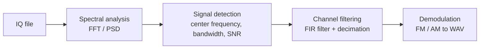
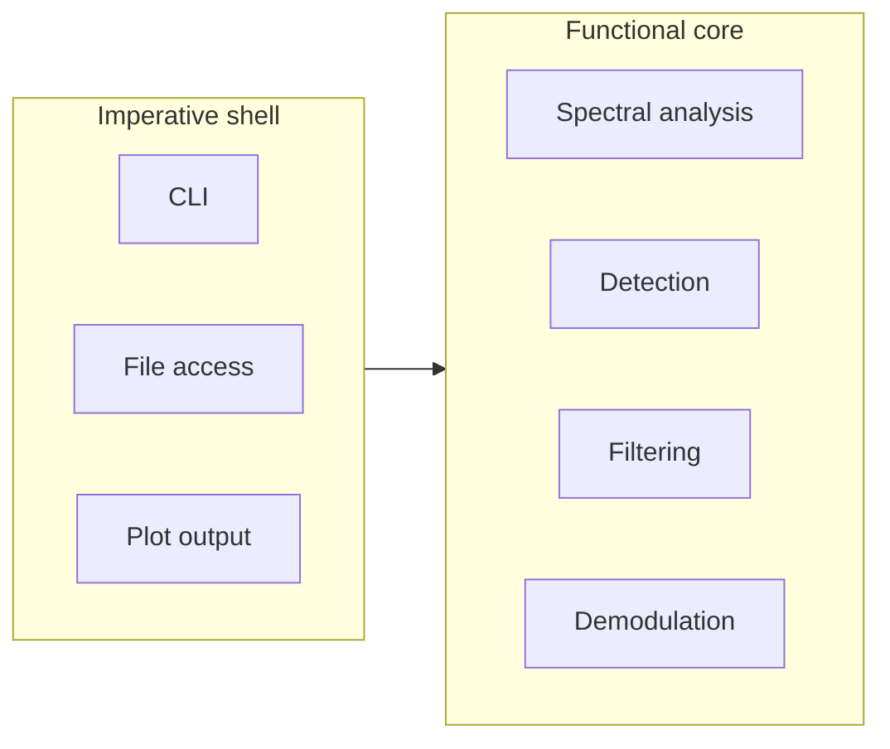

# iqscope

[](https://github.com/fgulde/iqscope/actions/workflows/build-test.yml)
[](https://www.python.org/)
[](https://codecov.io/gh/fgulde/iqscope)
[](https://github.com/fgulde/iqscope/commits/master)
[](LICENSE)

Command line tool for analyzing and demodulating IQ recordings (complex
baseband) as produced by a software defined radio or a spectrum analyzer.



Given a raw IQ capture, it produces spectrum/spectrogram plots, a report of
the detected signals (center frequency, bandwidth, SNR), and a demodulated `.wav` file.

## Current Status

**Early stage: raw IQ files can be read; no signal processing functionality yet.**

### Already Implemented

- Phase 0: project scaffold (`pyproject.toml`, tooling, CI, module skeleton)
- Phase 1: IQ reader (`cu8`, `ci8`, `ci16_le`, `cf32_le`, `cf64_le` → normalized
  `complex64`, format inference from file suffix, windowed reads)

### Planned

- Phase 2: synthetic signal generator
- Phase 3: spectral analysis
- Phase 4: signal detection & parameter estimation
- Phase 5: filter design & channel selection
- Phase 6: demodulation
- Phase 7: CLI, plots & documentation

## Tech Stack

- **Language:** Python 3.13
- **Package Manager:** uv
- **Build backend:** hatchling
- **Libraries:**
  - **Numerics:** NumPy, SciPy
  - **Plotting:** Matplotlib
  - **CLI:** Typer
  - **Testing:** pytest, pytest-cov, Hypothesis
- **Linting, formatting:** ruff
- **Type checking:** mypy (`--strict`)
- **Git hooks:** pre-commit
- **Task runner:** [just](https://github.com/casey/just)
- **CI:** GitHub Actions

## Quick Start

```bash
git clone https://github.com/fgulde/iqscope.git
cd iqscope

just setup
```

Run the quality gates locally (mirrors the CI workflows):

```bash
just lint        # ruff check + format --check
just typecheck    # mypy --strict
just test          # pytest + coverage
just check          # lint + typecheck + test
```

## Architecture

**Functional core, imperative shell.**

- The **core** (spectral analysis, detection, filtering, demodulation) is
  pure functions: NumPy arrays in, NumPy arrays or value objects out. No file
  I/O, no logging of results, no side effects, no global state.
- The **shell** (CLI, file access, plot output) is thin and contains no
  domain logic. It reads input, calls into the core, and writes output.

Dependencies point inward: the core knows nothing about the CLI or file
formats. Where a core component needs something from the outside (e.g. a
source of samples), that's expressed via a `typing.Protocol`, not a concrete
type.



## Project Structure

```
src/iqscope/
├── types.py               # shared type aliases (IQArray, RealArray), units
├── errors.py               # exception hierarchy
├── io/                      # raw formats → complex64, sample rate / metadata
├── synth/                   # synthetic signal generator (ground truth for tests)
├── spectral/                # window functions, FFT/PSD, spectrogram
├── detect/                  # noise floor, peak detection, parameter estimation
├── dsp/                      # FIR filter design, mixing, decimation
├── demod/                    # FM / AM demodulation
├── plotting/                 # Matplotlib output (presentation only)
└── cli.py                    # thin CLI adapter

tests/
├── unit/                     # unit tests for individual modules
├── property/                  # Hypothesis based invariant tests
└── integration/                # full pipeline: generator → analysis → result
```

## Testing Strategy

Three layers, all run via `pytest`:

1. **Unit tests**: individual functions against analytically known results
   (e.g. an FFT of a pure sine must show a single peak at the expected bin).
2. **Property tests** ([Hypothesis](https://hypothesis.readthedocs.io/)):
   invariants over randomly generated inputs. Parseval's theorem, linearity
   of the spectrum, decimating by a factor of one is the identity operation,
   and an FIR lowpass filter cannot increase signal energy.
3. **Integration tests against ground truth**: the synthetic generator
   produces a signal with a known SNR / frequency offset / bandwidth, and the
   estimate from the analysis pipeline is checked against that known value.

## License

MIT. See [LICENSE](LICENSE).
